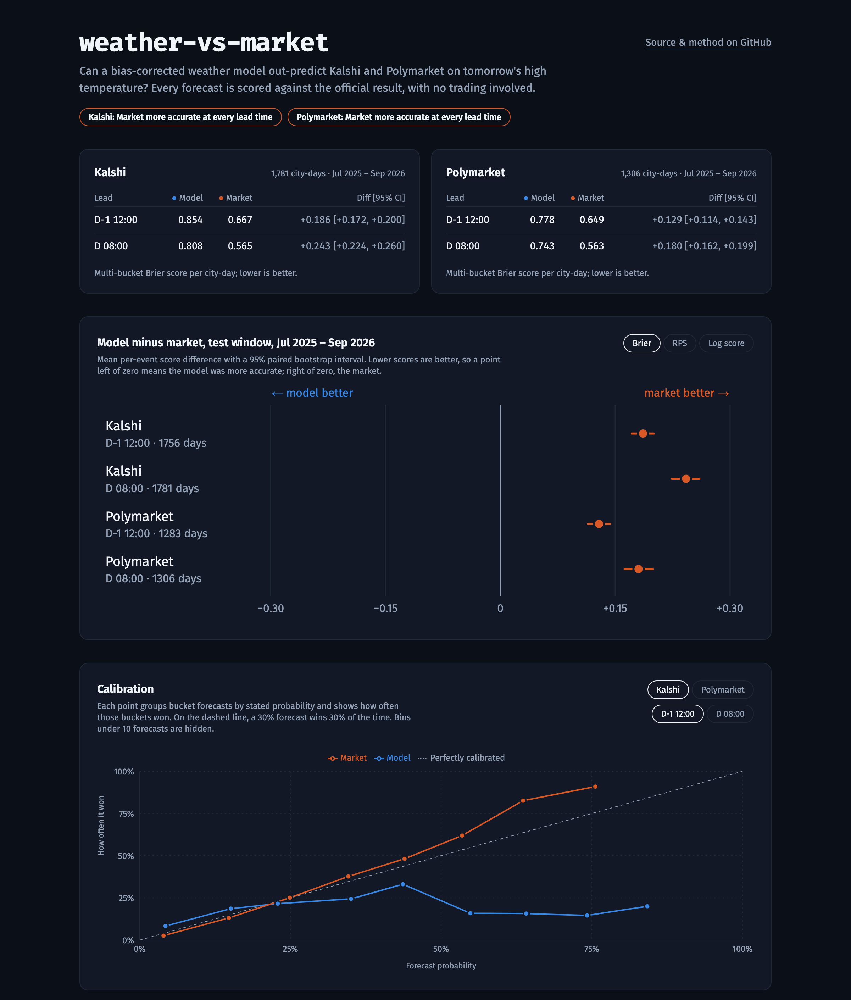
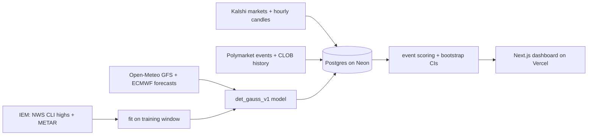

# weather-vs-market

[](https://github.com/Bensidebotham/mercury-forecast-verification/actions/workflows/test.yml)
[](LICENSE)

**Can a bias-corrected weather model out-predict Kalshi and Polymarket on tomorrow's high temperature?**

A read-only Python pipeline that rebuilds what the weather models and the betting markets said before each
day's high was known, scores both against the official result, and publishes the comparison to a live
dashboard. No trading happens anywhere in this repo; the deliverable is the measurement.

<!-- headline:start -->
**Out of sample (Jul 2025 – Sep 2026), the market was more accurate than the model at every lead time, on Kalshi (1,756–1,781 city-days per lead time) and Polymarket (1,283–1,306 city-days per lead time), on Brier, RPS and log score alike.** Every comparison uses a 95% paired bootstrap interval over city-days; see the table below and [docs/RESULTS.md](docs/RESULTS.md).
<!-- headline:end -->

<!-- results:start -->
| Venue | Lead | City-days | Model Brier | Market Brier | Model − market [95% CI] |
|---|---|---:|---:|---:|---|
| Kalshi | D-1 12:00 | 1,756 | 0.854 | 0.667 | +0.186 [+0.172, +0.200] |
| Kalshi | D 08:00 | 1,781 | 0.808 | 0.565 | +0.243 [+0.224, +0.260] |
| Polymarket | D-1 12:00 | 1,283 | 0.778 | 0.649 | +0.129 [+0.114, +0.143] |
| Polymarket | D 08:00 | 1,306 | 0.743 | 0.563 | +0.180 [+0.162, +0.199] |
<!-- results:end -->

**Live dashboard:** https://mercury-forecast-verification.vercel.app



## What it measures

Each day, Kalshi and Polymarket list a ladder of buckets for a city's high temperature ("82–83°F",
"84°F or above", …) that settles on one official weather station. For every settled ladder, the pipeline
takes the market's prices and the model's probabilities **at fixed local times before the day starts**
(noon the day before, and 08:00 on the day), then scores both against the venue's result.



The model, `det_gauss_v1`, is deliberately simple: the mean of the GFS and ECMWF forecasts issued one or
two days earlier, plus a per-station bias, with a Normal error whose width comes from the training window.
A second, ensemble-based model runs live every hour; Open-Meteo keeps no archive of ensemble runs, so it can
only be scored going forward.

## Why the numbers can be trusted

- **Pre-registered.** [docs/PROTOCOL.md](docs/PROTOCOL.md) fixes the windows, lead times, price rules,
  inclusion criteria and scores. It was committed before the test window was scored, and `git log` on the
  protocol and on `results/` shows the order. Model parameters are fit on 2024-01 to 2025-06 only and frozen
  in [`config/det_gauss_v1.params.json`](config/det_gauss_v1.params.json).
- **No look-ahead.** Every price and forecast is the latest one at or before the lead time. Each lead time
  is tied to the oldest forecast offset that was already published by then (`previous_day2` at noon the day
  before, `previous_day1` at 08:00), and a test checks that later prices are never used.
- **The right unit.** Buckets in one ladder are mutually exclusive, so the city-day is the unit: scores
  (multi-bucket Brier, ranked probability score, log score) are computed per city-day and the 95% intervals
  come from a paired bootstrap over city-days, not over correlated buckets.
- **Each venue on its own station.** Kalshi NYC settles on Central Park and Polymarket NYC on LaGuardia;
  Chicago is Midway vs. O'Hare. Each market is modeled and fit at the station it settles on.
- **Failures are not data.** A failed forecast fetch is skipped and counted, never stored as a 0% forecast.
  A one-sided order book is not a price. An hourly run that finds no markets fails the job.
- **Generated results.** The table above and [docs/RESULTS.md](docs/RESULTS.md) are written by the
  pipeline from `results/backtest_test.json`.

## Things the data taught me

- **The model's confident calls were its worst.** Buckets it gave more than 50% won far less often than
  stated (calibration chart above), while the market's forecasts tracked their outcomes. Nearly all were
  open-ended tail buckets on days when GFS and ECMWF disagreed by several degrees, or at Los Angeles, where
  the coastal grid point barely tracks the marine layer. Averaging the two models plus a year-round bias
  can't tell which model to trust; the market can, because it prices in the latest runs.

- **Hourly observations miss the peak.** The official NWS daily high runs above the highest hourly METAR
  reading at every station (see [`config/locked_obs.params.json`](config/locked_obs.params.json)). A model
  that trusted the hourly max put 93% on the wrong bucket in Miami on 2026-10-16.
- **Kalshi candles are sparse.** A candle only exists for an hour with activity, while the order book
  persists in between. A 2-hour staleness limit silently dropped most early-morning New York and Miami
  ladders; the protocol was amended before the test run (see its amendment note).
- **Settlement sources move.** Kalshi switched from the NWS climate report to The Weather Company around
  2026-08-14. Scores use each venue's own result, and the results report how often the two agree.
- **APIs drift silently.** Kalshi moved bucket labels and prices to new fields in 2026, and the old parser
  skipped every market without an error. Ingest now fails loudly on an empty cycle, and clients are tested
  against recorded real responses.

## Reproduce

```bash
uv sync
uv run pytest -q                                   # offline test suite

# Rebuild the backtest from public APIs (no keys needed; writes to local SQLite by default)
uv run wvm fit                                     # fit det_gauss_v1 on the training window
uv run wvm backtest collect kalshi --window test
uv run wvm backtest collect polymarket --window test
uv run wvm backtest forecast --window test
uv run wvm backtest score --window test            # -> results/backtest_test.json
uv run wvm backtest report                         # -> README table + docs/RESULTS.md
```

Set `DATABASE_URL` to use Postgres instead of SQLite. A weekly Parquet dump of every table is attached to
the [`data-latest` release](https://github.com/Bensidebotham/mercury-forecast-verification/releases/tag/data-latest)
for analysis without running anything.

## Live pipeline

`.github/workflows/ingest.yml` runs hourly: settle finished markets, snapshot open ones with the live model,
and publish a document the dashboard reads from Postgres through a read-only role. Fresh data needs no
commit or redeploy.

## Layout

```
src/weather_vs_market/
  clients/      Kalshi and Polymarket, live and historical (read-only, keyless)
  forecast/     Open-Meteo ensemble and Previous Runs, NWS station obs, IEM archives
  model/        bucket probabilities: live ensemble kernel, det_gauss_v1
  analysis/     event scoring, bootstrap intervals, calibration, live views
  pipeline/     ingest, settle, fit, backtest, publish, report
  storage/      SQLAlchemy store for SQLite and Postgres
frontend/       Next.js dashboard
docs/           PROTOCOL.md (pre-registration), RESULTS.md (generated)
```

## Limitations

- The model only sees forecasts a day or more old, by design, so that the backtest can't look ahead. The
  market sees the latest runs. This is a test of a stale-but-honest model, not of the best possible one.
- One bias and spread per station for the whole year; no seasonal terms.
- Polymarket history gives a trade price, not a bid/ask, and starts later (NYC Jan 2025, other cities
  Dec 2025 or Mar 2026), so its sample is smaller.

## License

[MIT](LICENSE)
